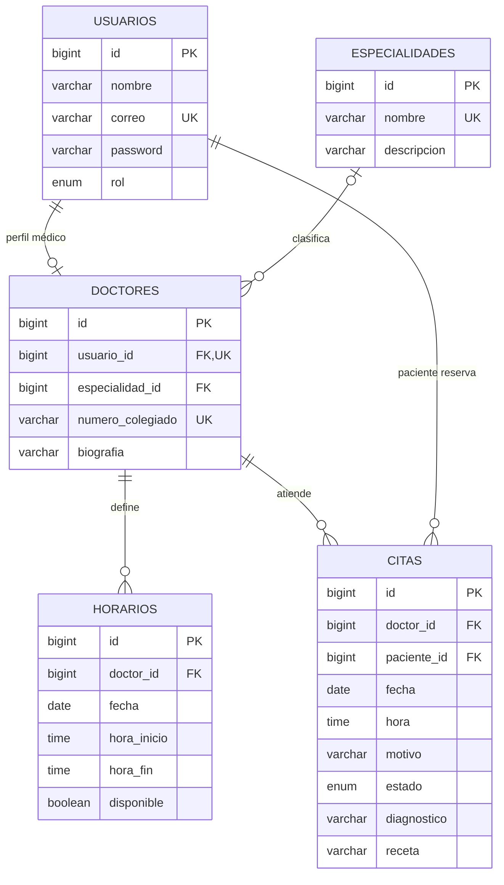

# Diagrama entidad-relación — Sistema de Citas Médicas

Fuente: `estructura_sistema_citas.sql` publicado en el repositorio. Las relaciones y restricciones se reflejan según el DDL. La entidad `doctores` se vincula con `usuarios` mediante `usuario_id UNIQUE`; `citas` referencia al médico y al paciente.

## Cardinalidades y claves

| Origen | Destino | Relación | Llave foránea |
|---|---|---|---|
| USUARIOS | DOCTORES | 1 a 0..1 | doctores.usuario_id (único) |
| ESPECIALIDADES | DOCTORES | 1 a N (especialidad opcional para el médico) | doctores.especialidad_id |
| DOCTORES | HORARIOS | 1 a N | horarios.doctor_id |
| DOCTORES | CITAS | 1 a N | citas.doctor_id |
| USUARIOS | CITAS | 1 a N (como paciente) | citas.paciente_id |

## Justificación breve de normalización

- **1FN:** los campos del esquema son atómicos (una fecha, una hora, un correo, etc.).
- **2FN:** todas las tablas tienen una clave primaria simple `id`; los campos no clave dependen de dicha clave completa.
- **3FN:** los datos de especialidades se conservan en su propia tabla y los datos de usuario no se duplican en perfiles médicos ni citas; se relacionan con claves foráneas. Esta es una justificación del **diseño** y debe acompañarse de una verificación con casos y dependencias funcionales en la entrega.

## Observaciones del esquema existente

- `doctores.especialidad_id` permite `NULL` y `ON DELETE SET NULL`.
- Las citas usan `estado` con valores `PENDIENTE`, `COMPLETADA` y `CANCELADA`.
- El DDL contiene índices `idx_citas_doctor_fecha`, `idx_horarios_doctor_fecha` y `idx_citas_paciente`.
- El diagrama es **del esquema actual**; no representa funcionalidades futuras de Ionic o reportería.
